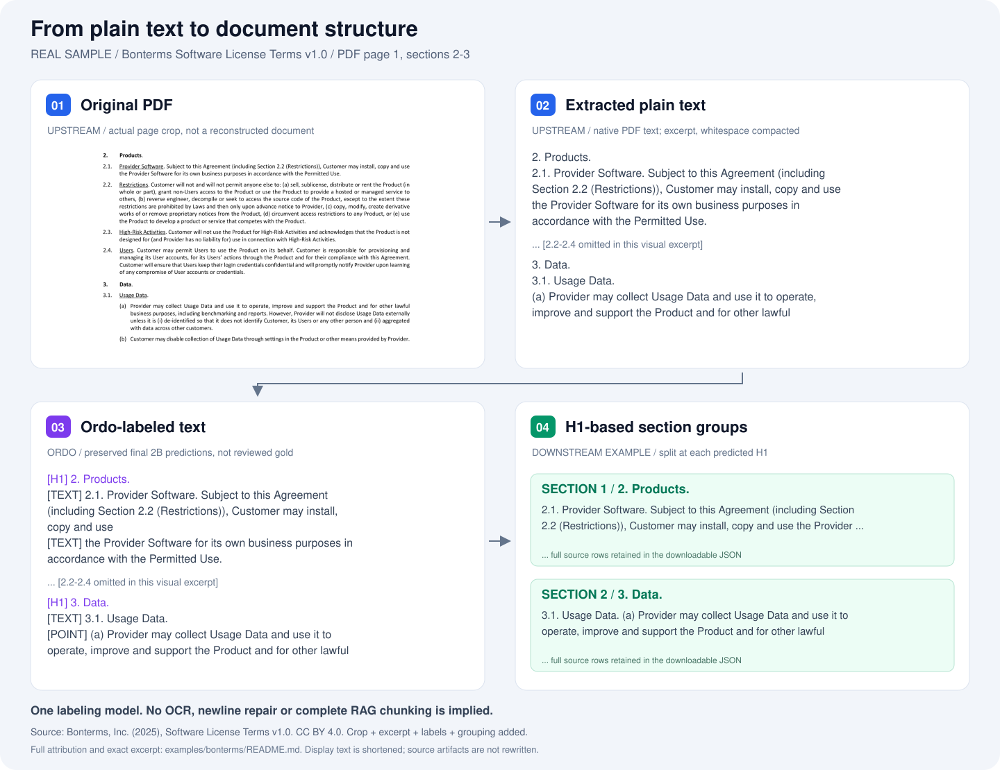

# Ordo 1.0

**Turn plain text into document structure — locally or through a model API.**

English · [简体中文](README.zh-CN.md) · [Download model](https://modelscope.cn/models/l424102993/Ordo_2B)

Ordo identifies document titles, headings, paragraphs, lists, tables, contents, appendices and page headers. It exports **JSON, label-aligned TXT and Markdown**, keeping the full source text and line IDs.

Use it to organize contracts, procedures, reports and other long documents, build a heading-based outline, or prepare structured input for downstream search and chunking.

The local **Qwen3.5-2B** model runs in a single labeling stage: no cloud key, separate analysis step or runtime LoRA required. An online few-shot mode is also available.

## See it in action



**PDF → plain text → Ordo labels → H1-based sections.** A real excerpt from the Bonterms Software License Terms, with actual 2B predictions.

[Explore the text, labels and section JSON](examples/bonterms/README.md) · Source: Bonterms, CC BY 4.0.

Ordo accepts **UTF-8 plain text**. PDF/Word extraction happens upstream; the H1 grouping shown here is a lightweight downstream example, not a complete RAG chunking library.

## What it recognizes

| Label | Meaning |
| --- | --- |
| `TEXT` | Body text, including numbered prose |
| `NEW_DOCUMENT` | Title starting a new document |
| `H1` | Top-level section heading |
| `H2` | Second-level heading |
| `H3` | Third-level or deeper heading |
| `HN` | Unnumbered local heading |
| `POINT` | An explicit list or enumeration item |
| `TOC` | A line in the document's existing table of contents |
| `TABLE` | A line belonging to a table |
| `APPENDIX` | An explicit appendix marker or title |
| `HEADER` | Page header, footer or page number |
| `INFO_PAGE` | Cover/front-matter metadata |

[Detailed label rules](docs/LABELS.md). Ordo labels the text it receives; it does not reconstruct missing tables or recover the original PDF layout.

## Results

On the same **114 documents / 35,821 lines**, comparing preserved online few-shot outputs with the final local model:

| Method | Label accuracy | H1 F1 | H2 F1 | H3 F1 |
| --- | ---: | ---: | ---: | ---: |
| Qwen3.7-Plus, Analyze + few-shot | 89.08% | 81.17% | 60.06% | 57.42% |
| Ordo 2B, single stage | **90.11%** | **90.68%** | **80.11%** | **88.75%** |

On the full **126-document / 43,423-line** Test set, Ordo reached **91.12% label accuracy**, processing the set in **539.5 seconds** on one RTX 3090 with 16 concurrent window requests, excluding model startup.

[Evaluation scope and detailed metrics](docs/BENCHMARKS.md).

## How to use it

### Choose a mode

| Mode | Best for | Entry |
| --- | --- | --- |
| Online few-shot | Getting started with an API key and no local GPU | `scripts/run_online_structure.sh` |
| Local in-process | Python / notebook workflows | [Notebook](notebooks/local_inprocess.ipynb) |
| Local decoupled | Calling an independent vLLM server | `scripts/serve_model.sh` + `ordo-label` |
| Text API | Serving other programs or LAN clients | [Service guide](docs/SERVICE.md) |

### Install and download

Use Python 3.10+ for the client/API. For GPU inference, use a separate Linux/NVIDIA environment with Python 3.12.

```bash
git clone https://github.com/lyxx3rd/Ordo.git
cd Ordo
python -m pip install -r requirements.txt

# In the GPU environment:
python -m pip install -r requirements-model.txt

# Optional, for notebooks:
python -m pip install -r requirements-notebook.txt
```

Download the merged model from [ModelScope](https://modelscope.cn/models/l424102993/Ordo_2B). With the optional ModelScope SDK installed:

```python
from modelscope import snapshot_download
model_dir = snapshot_download("l424102993/Ordo_2B")
```

[Model and environment details](docs/MODELS.md).

### 1. Online few-shot

```bash
cp ordo/config.example.yaml ordo/config.yaml
export ORDO_ONLINE_API_KEY='YOUR_PROVIDER_KEY'
# Configure a model and endpoint supported by your provider.
bash scripts/run_online_structure.sh examples/sample.txt outputs/online_example
```

This mode analyzes the whole text, then labels it with examples. It saves labels, TXT, Markdown, outline and usage records. Keep keys and private configuration out of Git.

### 2. Local in-process

Run the [notebook](notebooks/local_inprocess.ipynb), or call the model from Python:

```python
from ordo_local.offline import load_model, label_text
from ordo_local.client import save_result

llm = load_model("/path/to/Ordo-Qwen3.5-2B-Reviewed2-Final-BF16")
result = label_text(llm, "Document title\n\n1. Scope\n\nBody text.")
save_result(result, "outputs/inprocess_example")
```

Select the GPU with `CUDA_VISIBLE_DEVICES` before importing torch/vLLM. No HTTP service is needed.

### 3. Local decoupled

Start the model in the GPU environment:

```bash
export ORDO_MODEL_PATH=/path/to/Ordo-Qwen3.5-2B-Reviewed2-Final-BF16
GPU=0 bash scripts/serve_model.sh
```

Call it from the client environment:

```bash
ordo-label examples/sample.txt --output outputs/local_example \
  --base-url http://127.0.0.1:8010/v1 --model ordo-final-2b --format json txt md
```

Outputs: `labels.json`, `labeled.txt`, `labeled.md` and `run.json`. Existing files are not overwritten. This mode does not need the business API below.

### 4. Deploy a text API

```bash
cp local_service/config.example.json local_service/config.local.json
# Set model_path, model_python, GPU and ports.
ordo-local init-token --config local_service/config.local.json
bash local_service/start.sh
```

The manager starts the model and API in the background. Do not also start Mode 3 on the same GPU/port.

| Endpoint | Purpose |
| --- | --- |
| `GET /health` | API liveness |
| `GET /ready` | Model readiness |
| `POST /v1/label` | Submit text as JSON |
| `POST /v1/label/file` | Upload a UTF-8 TXT file |

```json
{"text":"Document title\n\n1. Scope\n\nBody text.", "format":["json","txt","md"]}
```

The response contains a `files` array with each file's name, media type and text content. Choose one or multiple formats; no ZIP is required.

For LAN access, bind `api_host` to `0.0.0.0` and use the server's reachable IP. Authentication is enabled by default; `auth_enabled: false` explicitly allows any network-reachable caller.

[Full API examples, background operation and configuration](docs/SERVICE.md).

## More

- [Model download and hardware notes](docs/MODELS.md)
- [Label rules](docs/LABELS.md)
- [Evaluation details](docs/BENCHMARKS.md)
- [Changelog](CHANGELOG.md)
- [Apache-2.0 license](LICENSE)

Code and weights are distributed separately. Source documents and training datasets are not bundled. Future work: structured-document → RAG chunk indexing.
